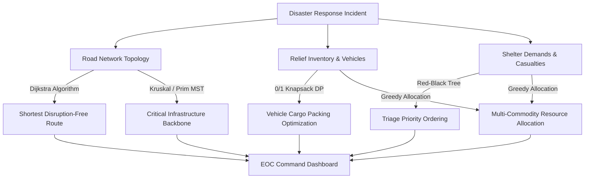

# 🚨 Disaster Response Logistics Optimization System (EOC)

[](index.html)
[](js/app.js)
[](css/style.css)
[](js/networkMap.js)
[](#-core-algorithms--computational-complexity)
[-teal.svg)](#-project-directory-structure)

An intelligent **Emergency Operations Center (EOC) Logistics & Supply Chain Optimization Platform** developed as an advanced **Design and Analysis of Algorithms (DAA)** project in modern Web format.

The application solves high-stakes humanitarian logistics challenges during severe natural disaster crises—such as major earthquakes, flash floods, avalanches, and landslides across Nepal. By integrating classical and advanced algorithmic paradigms (Graph Theory, Greedy Heuristics, Dynamic Programming, and Self-Balancing Trees) with an interactive HTML5 Canvas topology visualization and real-time state reactivity, the system provides real-time situational awareness, route calculation, critical supply rationing, and road disruption simulation.

---

## 📑 Table of Contents

- [Overview & Motivation](#-overview--motivation)
- [Key Features](#-key-features)
- [Core Algorithms & Computational Complexity](#-core-algorithms--computational-complexity)
  - [1. Dijkstra's Algorithm (Emergency Route Finding)](#1-dijkstras-algorithm-emergency-dispatch--evacuation-routing)
  - [2. Kruskal's Algorithm (Network Backbone MST)](#2-kruskals-algorithm-minimum-cost-road-reconnection)
  - [3. Prim's Algorithm (Depot-Centric Grid Expansion)](#3-prims-algorithm-depot-centric-infrastructure-expansion)
  - [4. 0/1 Knapsack Problem (Payload Utility Maximization)](#4-01-knapsack-problem-optimal-cargo-payload-packing)
  - [5. Greedy Resource Allocation (Multi-Commodity Rationing)](#5-greedy-resource-allocation-multi-commodity-rationing)
  - [6. Red-Black Tree (Triage & Priority Queueing)](#6-red-black-tree-dynamic-disaster-triage-indexing)
- [Algorithm Complexity Summary Table](#-algorithm-complexity-summary-table)
- [Preloaded Disaster Scenarios](#-preloaded-disaster-scenarios)
- [Tech Stack & Architecture](#-tech-stack--architecture)
- [Project Directory Structure](#-project-directory-structure)
- [Installation & Quick Start](#-installation--quick-start)
- [License & Academic Attribution](#-license--academic-attribution)

---

## 🌍 Overview & Motivation

During natural disasters (e.g., the 2015 Gorkha Earthquake or monsoon flash floods in Nepal), emergency response commanders face several critical logistical bottlenecks:
1. **Compromised Infrastructure**: Roads and bridges are blocked or collapsed, preventing standard GPS routing from functioning safely.
2. **Resource Scarcity**: Emergency vehicle capacity is strictly bounded, requiring life-saving relief cargo (medical supplies, water purification, rations) to be triaged to maximize survival utility.
3. **Multiple Competing Shelters**: Shelters, camps, and field hospitals submit urgent requests simultaneously with varying severity and deadlines.
4. **Dynamic Operational Constraints**: Roads can get blocked or cleared dynamically, necessitating real-time algorithm re-execution.

This system provides emergency response directors with a unified digital web dashboard that dynamically computes optimal routing, spanning tree infrastructure, triage queues, and multi-commodity resource distribution in real time.

---

## ✨ Key Features

- 📊 **EOC Executive KPI Dashboard**: Real-time monitoring of total affected population, active supply depots, available relief inventories, and percentage demand fulfillment.
- 🗺️ **Interactive Geographic Network Map**:
  - Full mouse gesture support (smooth pan drag, mouse wheel zoom, reset bounds).
  - Visual distinctions for node types (Depots, Hospitals, Shelters).
  - Live status indicators for road corridors (Open vs. Blocked).
  - Visual highlights for computed Minimum Spanning Tree (Green) and Dijkstra Shortest Paths (Blue animated beam).
  - **Click-to-block roads**: Click any road line directly to toggle landslides and watch the algorithm reroute live!
- ⚙️ **Algorithm Control Panel & Workbench**: Direct interactive parameter adjustment for route search, vehicle payload capacity, and real-time algorithm inspection.
- 🚧 **Road Disruption Simulator & Real-time Rerouting**: Toggle landslides/blockages on specific road corridors to observe automatic algorithmic recalculation across Dijkstra and MST models.
- 🏔️ **10 Real-world Nepal Disaster Scenarios**: Pre-seeded scenarios ranging from Kathmandu earthquakes to Himalayan blizzards and Chitwan landslides.
- 🔄 **Zero-Build Step Execution**: Pure ES6+ modular JavaScript and Vanilla CSS that runs instantly in any browser.

---

## 🧠 Core Algorithms & Computational Complexity



### 1. Dijkstra's Algorithm (Emergency Dispatch & Evacuation Routing)
- **File**: [`js/algorithms/dijkstra.js`](js/algorithms/dijkstra.js)
- **Logistics Purpose**: Identifies the fastest or shortest safe route between any supply depot, hospital, or evacuation shelter.
- **Handling Disruptions**: Road segments marked with `status == "Blocked"` (landslides, fallen debris, flooded bridges) are skipped dynamically by the relaxation step.
- **Data Structures**:
  - Min-Priority Queue (`PriorityQueue`) for extracting the vertex with the lowest known distance.
  - Adjacency list representation: `Map<string, Array<Edge>>`.
  - Parent pointers: `previousNodes` map for path reconstruction.
- **Complexity**:
  - **Time**: $\mathcal{O}((V + E) \log V)$
  - **Space**: $\mathcal{O}(V + E)$

### 2. Kruskal's Algorithm (Minimum-Cost Road Reconnection)
- **File**: [`js/algorithms/kruskal.js`](js/algorithms/kruskal.js)
- **Logistics Purpose**: When an earthquake severs regional links, engineering and rescue teams must restore minimum connectivity across all hubs with the least clearing effort and repair distance.
- **Implementation**:
  - Valid edges (`status != "Blocked"`) are sorted ascending by distance.
  - A custom **Disjoint Set Union (DSU)** structure with **Path Compression** and **Union by Rank** ensures cycle-free edge inclusion.
- **Complexity**:
  - **Time**: $\mathcal{O}(E \log E)$ or $\mathcal{O}(E \log V)$
  - **Space**: $\mathcal{O}(V + E)$

### 3. Prim's Algorithm (Depot-Centric Infrastructure Expansion)
- **File**: [`js/algorithms/prim.js`](js/algorithms/prim.js)
- **Logistics Purpose**: Constructs an MST expanding outwards directly from an active central distribution depot, ensuring that every newly added cluster maintains a direct chain of custody back to the base.
- **Implementation**:
  - Employs a Min-Priority Queue of edges and a visited vertex set to greedily select the lightest cut edge.
- **Complexity**:
  - **Time**: $\mathcal{O}(E \log V)$
  - **Space**: $\mathcal{O}(V + E)$

### 4. 0/1 Knapsack Problem (Optimal Cargo Payload Packing)
- **File**: [`js/algorithms/knapsack.js`](js/algorithms/knapsack.js)
- **Logistics Purpose**: Emergency transport helicopters and relief trucks have strict gross vehicle weight ratings (payload limits). The knapsack solver determines the combination of relief supplies (Medical Kits, Food Rations, Water, Fuel) that maximizes life-saving utility without overloading the vehicle.
- **Implementation**:
  - Bottom-up 2D Dynamic Programming table: `dp[N+1][Capacity+1]`.
  - Recurrence relation:
    $$\text{dp}[i][c] = \max(\text{dp}[i-1][c],\, \text{dp}[i-1][c - w_i] + v_i)$$
  - Backtracking pass to reconstruct the exact subset of selected resources.
- **Complexity**:
  - **Time**: $\mathcal{O}(N \cdot W)$ (Pseudo-polynomial, where $N$ = items, $W$ = vehicle capacity)
  - **Space**: $\mathcal{O}(N \cdot W)$

### 5. Greedy Resource Allocation (Multi-Commodity Rationing)
- **File**: [`js/algorithms/greedy.js`](js/algorithms/greedy.js)
- **Logistics Purpose**: When overall demand outstrips available stock across regional depots, resources must be rationed based on triage severity.
- **Implementation**:
  - Demands are sorted in ascending order of priority rank (Priority 1 = Critical, Priority 2 = Urgent, Priority 3 = Moderate).
  - Iteratively allocates food, potable water, and trauma kits from depot inventory to satisfy highest-priority demands first.
- **Complexity**:
  - **Time**: $\mathcal{O}(D \log D + D \cdot R)$ (where $D$ = demand hubs, $R$ = available supply batches)
  - **Space**: $\mathcal{O}(R)$

### 6. Red-Black Tree (Dynamic Disaster Triage Indexing)
- **File**: [`js/algorithms/redBlackTree.js`](js/algorithms/redBlackTree.js)
- **Logistics Purpose**: Incoming emergency calls and incident reports arrive continuously. A self-balancing binary search tree maintains a dynamically sorted triage order by urgency priority, survival deadline, and incident identifier.
- **Implementation**:
  - Custom node implementation with `Color.RED` and `Color.BLACK`.
  - Standard balancing invariants maintained via `rotateLeft()`, `rotateRight()`, and `fixInsert()`.
  - In-order traversal (`getSortedDemands()`) produces an ordered queue for emergency dispatchers.
  - Generates visual tree hierarchy structure for live DOM rendering.
- **Complexity**:
  - **Insertion**: $\mathcal{O}(\log N)$
  - **Search / Lookup**: $\mathcal{O}(\log N)$
  - **Sorted In-Order Traversal**: $\mathcal{O}(N)$
  - **Space**: $\mathcal{O}(N)$

---

## 📊 Algorithm Complexity Summary Table

| Algorithm | Paradigm | Time Complexity (Worst) | Space Complexity | Practical Logistics Function |
| :--- | :--- | :--- | :--- | :--- |
| **Dijkstra** | Greedy / Priority Queue | $\mathcal{O}((V + E) \log V)$ | $\mathcal{O}(V + E)$ | Evacuation / medical transport routing avoiding blocked passes |
| **Kruskal's MST** | Greedy / Disjoint Set Union | $\mathcal{O}(E \log E)$ | $\mathcal{O}(V + E)$ | Minimum road clearance cost to reconnect isolated hubs |
| **Prim's MST** | Greedy / Cut Property | $\mathcal{O}(E \log V)$ | $\mathcal{O}(V + E)$ | Direct depot-centric outbound utility/supply corridor restoration |
| **0/1 Knapsack** | Dynamic Programming | $\mathcal{O}(N \cdot W)$ | $\mathcal{O}(N \cdot W)$ | Maximizing survival value of helicopter/truck cargo payloads |
| **Greedy Allocation** | Greedy Sorting | $\mathcal{O}(D \log D + D \cdot R)$ | $\mathcal{O}(R)$ | Multi-commodity supply rationing by casualty triage rank |
| **Red-Black Tree** | Self-Balancing BST | $\mathcal{O}(\log N)$ per operation | $\mathcal{O}(N)$ | Real-time concurrent incident triage prioritization queue |

---

## 🏔️ Preloaded Disaster Scenarios

| Scenario ID | Name | Hazard Classification | Operational Characteristics |
| :---: | :--- | :--- | :--- |
| `SCENARIO_1` | **Kathmandu Earthquake** | Seismic Destruction | Urban collapsed structures, arterial debris, hospital access triage |
| `SCENARIO_2` | **Pokhara Flood** | Flash Flood / Inundation | River swelling, bridge damages, shelter access severance |
| `SCENARIO_3` | **Chitwan Landslide** | Terrain Failure / Highway Blockage | Terai arterial corridor blockage, essential supply chain cutoff |
| `SCENARIO_4` | **Lalitpur Wildfire** | Urban-Forest Edge Fire | Rapid evacuation demands, burn trauma medical supply priorities |
| `SCENARIO_5` | **Bhaktapur Earthquake** | Heritage & High-Density Seismic Event | Dense alley access issues, emergency medical routing |
| `SCENARIO_6` | **Everest Base Camp Avalanche** | High-Altitude Cryospheric Hazard | Severe hypothermia, high-value medical payload helicopter transport |
| `SCENARIO_7` | **Annapurna Blizzard** | Mountain Storm / Trekker Stranding | Route isolation, high-priority survival ration delivery |
| `SCENARIO_8` | **Lumbini Heatwave** | Extreme Meteorological Event | Severe potable water shortages, vulnerable population triage |
| `SCENARIO_9` | **Dharan Storm** | Severe Wind & Flash Flooding | Fallen trees, power line severances, infrastructure reconnection |
| `SCENARIO_10` | **Janakpur Epidemic** | Post-Flood Waterborne Disease Outbreak | High medical utility knapsack optimization, clinic supply distribution |

---

## 🛠️ Tech Stack & Architecture

- **Structure**: Semantic HTML5 with accessible HUD elements (`index.html`)
- **Styling**: Vanilla CSS3 with CSS Custom Properties, Glassmorphism, Neon Telemetry, and Responsive Flex/Grid (`css/style.css`)
- **Logic & Algorithms**: Modular JavaScript (ES6+ Modules)
- **Map & Topology**: HTML5 Canvas 2D Context API with High-DPI support (`js/networkMap.js`)
- **Typography**: Google Fonts (`Outfit`, `Inter`, `JetBrains Mono`)
- **Build Requirements**: **Zero build step required** (Native browser execution)

---

## 📂 Project Directory Structure

```text
disaster-response-logistics/
├── css/
│   └── style.css                 # EOC tactical dark theme, glassmorphism, animations
├── js/
│   ├── algorithms/
│   │   ├── dijkstra.js           # Dijkstra shortest path with Min-PQ & rerouting
│   │   ├── kruskal.js            # Kruskal MST with Disjoint Set Union (DSU)
│   │   ├── prim.js               # Prim MST depot-centric expansion
│   │   ├── knapsack.js           # 0/1 Knapsack Dynamic Programming solver
│   │   ├── greedy.js             # Multi-commodity triage resource allocator
│   │   └── redBlackTree.js       # Self-balancing Red-Black Tree triage visualizer
│   ├── data/
│   │   └── scenarios.js          # 10 realistic Nepal disaster scenarios & coordinates
│   ├── networkMap.js             # Interactive HTML5 Canvas topology visualizer
│   └── app.js                    # Main EOC application controller & state coordinator
├── index.html                    # Single-Page Application entry point
├── .gitignore                    # Web project ignore configuration
└── README.md                     # Project documentation
```

---

## 🚀 Installation & Quick Start

### Option 1: Double-Click Direct Launch
Double-click [`index.html`](index.html) to open the application directly in any web browser (Google Chrome, Microsoft Edge, Mozilla Firefox, Safari).

### Option 2: Using Python (Recommended)
From the project root folder:
```bash
python -m http.server 8085
```
Open your browser to: **`http://localhost:8085`**

### Option 3: Using Node.js
```bash
npx serve .
```

---

## 📜 License & Academic Attribution

This project is developed as an academic coursework submission for **Design and Analysis of Algorithms (DAA)**.

- **Author**: Uday Kumar & Project Contributors
- **Course**: Design and Analysis of Algorithms (CS / Software Engineering)
- **License**: MIT License — open for academic study, research, and non-commercial extension.
